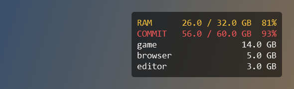

# DisplayOverlay

A small always-on-top overlay for Windows. It shows how much memory your computer has left, in a
corner of the screen, also above a game. It takes no clicks and no focus, and it does not touch
the game.



- **RAM and commit memory**, with a warning color and an alarm color at limits you choose.
- **Top programs**: the programs that use the most RAM. The processes of one program are added up,
  so 30 browser processes are one line. The number is the RAM that the program does not share with
  others, as in the column "Memory" of Task Manager. The settings can show commit memory instead,
  the optional column "Commit size" on the Details tab.
- **Always show**: a group of programs that you choose. It keeps its line, also when it is too
  small for the top.
- **Settings**: monitor, corner, distance from the edge, text size, colors, background opacity,
  and what is shown. Every change shows at once.
- **Start with Windows**, if you turn it on.

Built with Python and [PySide6](https://doc.qt.io/qtforpython-6/) (Qt), and developed with the help
of [Claude](https://www.anthropic.com/claude) (Anthropic). Status: an early version, developed and
tested on Windows 10 with Python 3.14.

## Why commit memory?

Windows has two memory limits, and most overlays show only the first.

- **RAM** is the memory that programs use now. When it is full, Windows moves data to the page
  file, and the computer gets very slow.
- **Commit memory** is what programs have reserved. RAM and the page file together must be able to
  hold it, and their sum is the commit limit. At this limit a program gets no more memory, even
  when RAM is still free.

Games often reserve much more than they use: a game can reserve 30 GB with only 10 GB in RAM. Task
Manager shows both numbers under Performance → Memory, as "In use" and "Committed". If you often
reach the commit limit, a bigger page file raises the limit for free. See Microsoft's
[page file guide](https://learn.microsoft.com/en-us/troubleshoot/windows-client/performance/how-to-determine-the-appropriate-page-file-size-for-64-bit-versions-of-windows)
and Mark Russinovich's
[Pushing the Limits of Windows: Virtual Memory](https://learn.microsoft.com/en-us/archive/blogs/markrussinovich/pushing-the-limits-of-windows-virtual-memory).

## Install

DisplayOverlay runs on Windows 10 and 11.

**Download** (no Python needed): get `DisplayOverlay-<version>-windows.zip` from the
[latest release](https://github.com/xv8mna/display-overlay/releases/latest) and unzip it into a
folder of yours. Start `DisplayOverlay.exe` in the folder `DisplayOverlay`. The program is not
signed: if Windows says "Windows protected your PC", click "More info", then "Run anyway".

**From source** (Python 3.12 or newer, and Git):

```
git clone https://github.com/xv8mna/display-overlay.git
cd display-overlay
py -m venv .venv
.venv\Scripts\python -m pip install .
.venv\Scripts\display-overlay
```

## Use

The overlay appears when the program starts, and its icon appears in the notification area of the
taskbar. Click the icon to open the settings. Right-click it to hide the overlay or to quit.

Settings are saved in `%APPDATA%\DisplayOverlay\settings.json`. The log file is in
`%LOCALAPPDATA%\DisplayOverlay`. "Start with Windows" adds one value to the Run key of your user
account, so it needs no admin rights, and Task Manager lists it under Startup.

## Games

The overlay is a normal window of its own. That is why it can't trip an anti-cheat program by
touching the game, and also why it has one limit: **Windows gives a game in exclusive fullscreen
the whole screen**, so the overlay may not show there. If that happens:

1. Set the game to borderless or windowed fullscreen. Most games have this in the video settings.
2. Or put the overlay on a second monitor.

A window above a game can add a small input delay. If that matters in a game, hide the overlay
there.

## What it does not do

- **No FPS.** A program outside the game can't see the frames. The overlay of your graphics driver
  or of Steam can show them, and they can run beside this one.
- **No RAM cleaner.** A cleaner moves data out of RAM, but the data stays reserved, so commit
  memory does not go down. The data then has to come back from the disk, which is slower.
- **It closes nothing.** It shows numbers and changes nothing on your computer.

## Privacy

DisplayOverlay works offline. It reads the names and memory sizes of running programs to show them
on your screen, and it sends nothing anywhere.

## Development

```
.venv\Scripts\python -m pip install -e .[dev]
.venv\Scripts\python -m pytest
.venv\Scripts\python -m ruff check src tests tools
```

`memory.py` reads the numbers, `rows.py` turns them into text, and `overlay.py` draws them. The
first two have no Qt in them. `tools\build.py` builds the Windows download; its first lines say
how.

## License

[MIT](LICENSE). PySide6 has its own license (LGPL-3.0). This repository holds no copy of it; pip
installs it. The Windows download includes Python, Qt and PySide6, and its `README.txt` and folder
`licenses` have their licenses.
